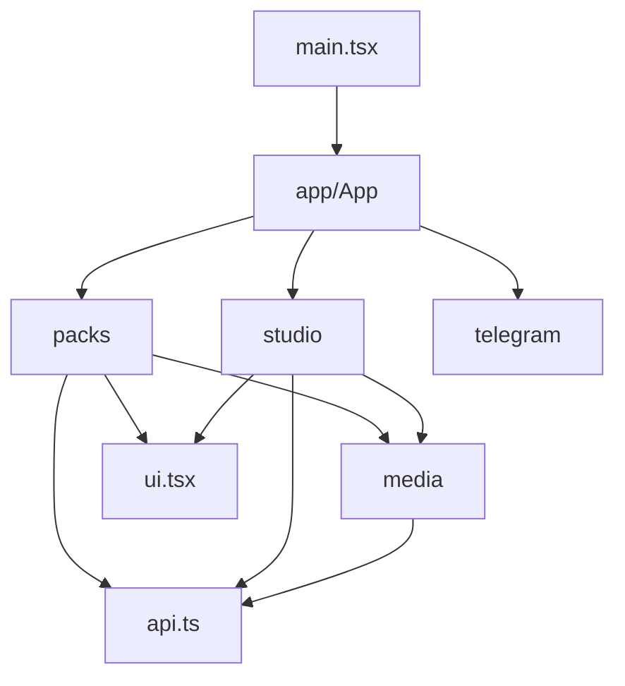

# Architecture

StickerBot has one domain context: creating and editing Telegram sticker packs.
The domain language is defined in [GLOSSARY.md](../GLOSSARY.md).

## Repository map

```text
app/bot/                   Telegram polling, commands and localization
backend/
  main.py                  FastAPI composition and lifecycle
  routers/                 Authentication, request validation and responses
  services/
    publication.py         Pack mutation ownership and publication reconciliation
    media_store.py         Owned media, registration, originals and expiry
    processing.py          Shared media capacity and blocking execution
    media/                 Downloading, rendering and private preview caching
  storage.py               SQLite schema, migrations and pack ownership
  backup.py                Credential-free snapshots and recovery
frontend/src/
  main.tsx                 Browser entrypoint
  app/                     Screen navigation, task status and integration tests
  packs/                   Pack library, creation, ordering, viewing and deletion
  studio/                  Source selection, editing, rendering and publication
  media/                   Browser playback
  telegram/                Mini App lifecycle, viewport and swipe protection
  api.ts                   Authenticated requests and shared private media cache
  types.ts                 Domain data and collaboration contracts
  ui.tsx                   Shared icon, image and dialog behavior
  style.css                Shared visual rules
common/                    Logging shared by backend and bot
tests/
  conftest.py              Test environment and isolated client fixture
  support.py               Fake Telegram adapter and signed test authentication
  test_*.py                Backend, bot, security and operations scenarios
  preview_server.py        Local visual fixture using the shared Telegram adapter
scripts/                   Container verification
docs/                      Architecture and operations
```

`app/webapp/` is generated output from the frontend build, not frontend source.
`data/`, virtual environments, dependency caches and generated browser assets
are excluded from Git. Keep runtime files out of source directories.

## Frontend ownership



`App` coordinates screen changes, the selected Pack and shared task status.
`PackScreen` owns order and emoji drafts, pointer behavior, viewing and deletion.
`StickerViewer` owns its current position, swipes and neighboring media loading.
`Studio` owns the Source-to-Render-to-Publication flow, including replacement
preparation and navigation within the editor. `Editor` owns crop and trim
interaction.

Keep Pack mounted while Studio is open: returning from an edit must preserve
an unsaved order or emoji draft. Screen handles expose navigation and successful
publication; App does not manipulate a feature's internal setters. Shared task
execution rejects overlapping operations and retains one place for busy and
error messages.

Features import shared code and domain types. They do not import App or each
other's internal state. Add behavior to its owning module before considering a
new shared abstraction. Keep interaction state and its cleanup together. A file
move alone does not improve depth or locality.

## Backend and bot ownership

Routes validate incoming requests and enforce authentication. Pack publication
and retry reconciliation belong in `publication.py`; media ownership, paired
original files and expiry belong in `media_store.py`. Rendering and download
implementation belongs in `services/media/`.

The preview producer owns capacity until rendering and temporary-file cleanup
finish, even if an HTTP waiter disconnects. Preserve that ownership when adding
new cache consumers. Pack writes share the process-local user operation guard.
The application currently requires one backend worker; moving files does not
make these guards or the cache distributed.

The bot talks to backend over authenticated HTTP. Do not import backend modules
into the bot: its lightweight container target intentionally omits backend and
FFmpeg. Shared logging belongs in `common/`, not in either runtime's transport.

## Tests and development

Frontend page flows are tested through App with a mocked transport seam in
`frontend/src/app/App.test.tsx`; transport/cache behavior is checked in
`frontend/src/api.test.ts`. Preserve these tests when changing internal module
organization. Add focused coverage when changing behavior or interaction
lifetimes.

Python test modules consume the `client` fixture through pytest discovery.
Shared helpers and the Telegram adapter belong in `tests/support.py`, never in
a `test_*.py` module imported by other tests or the visual fixture. `conftest.py`
sets test-only credentials and disables dotenv before importing application
modules. Every client fixture uses a temporary data directory.

Production entrypoints remain `backend.main:app` and `run_bot.py`; health and
recovery use `app.bot.health` and `backend.backup`. Frontend output remains
`app/webapp/`, served at `/app/`. Keep Docker, Compose, CI and local preview
commands consistent with these contracts.

Environment setup, verification commands, resource limits, schema migration and
recovery are documented in [operations.md](operations.md).
